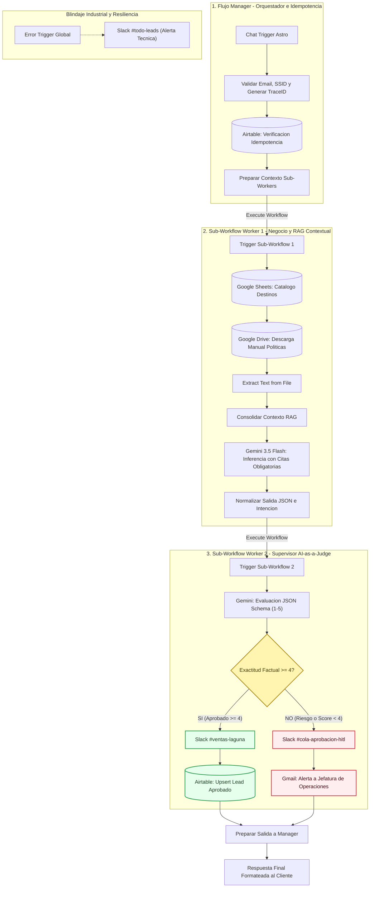

# ✈️ Despliegue y Gobernanza de un Ecosistema Agéntico Asincrónico y Supervisado para Viajes Laguna

## 📌 Ficha Técnica del Proyecto

| Parámetro | Detalle |
| --- | --- |
| **Proyecto** | Ecosistema Agéntico Asincrónico, RAG Dual y Gobernanza Activa (AI-as-a-Judge) |
| **Autor / Consultor** | **Javier Vélez Ríos** |
| **Programa** | Certificación en AI Automation Avanzado — Módulo 11 (Proyecto Final Integrador) |
| **Institución** | Coderhouse |
| **Cohorte** | 2026 |
| **Entorno & Costos** | n8n Self-Hosted (Infraestructura 100% Freemium / Free-tier) |

---

## 📖 Resumen Ejecutivo

**Viajes Laguna** es una agencia de viajes boutique con sede en México especializada en rutas e itinerarios personalizados hacia **Sudamérica y Europa**. Antes del despliegue de esta solución, la operación comercial enfrentaba tres cuellos de botella críticos:

```text
┌────────────────────────────────────────────────────────────────────────────────────────┐
│                                 DIAGNÓSTICO OPERATIVO                                  │
├──────────────────────────┬─────────────────────────────┬───────────────────────────────┤
│ 1. Lead Time Comercial   │ 2. Fuga Patrimonial         │ 3. Sobrecarga Administrativa  │
│    12 a 18 horas         │    Hasta $15,000 USD/año    │    >65% del tiempo comercial  │
│    Demora en cotizar y   │    Pérdidas por promesas    │    Consumido en consultas     │
│    responder normativas. │    indebidas de reembolso.  │    repetitivas de visados.    │
└──────────────────────────┴─────────────────────────────┴───────────────────────────────┘
```

### Solución Diseñada
Se implementó un ecosistema agéntico modular bajo el patrón **Manager-Worker** con compuerta de calidad estricta (**Quality Gate**) basada en **AI-as-a-Judge**:

* **RAG Dual en Tiempo Real:** Extracción desacoplada desde Google Sheets (tarifas dinámicas) y Google Docs (manual normativo y penalizaciones).
* **Idempotencia Transversal:** Trazabilidad de punta a punta con identificadores únicos `TraceID` (`VL-TRC-...`) y desduplicación contra Airtable.
* **Supervisión Ciega y HITL:** Un LLM independiente audita cada respuesta. Si la exactitud factual es menor a 4/5, el sistema **congela la autonomía**, entrega una respuesta de contención al cliente y deriva la alerta a una cola humana (**Human-in-the-Loop**).

---

## 🏛️ Arquitectura y Patrones de Diseño

El sistema descarta arquitecturas monolíticas en favor de tres flujos desacoplados invocados mediante sub-workflows:



---

## 📂 Desglose de Workflows

### 1. `Main Manager` (`tucH9wNWdwS9io9E`)
* **Entrada:** `Chat Trigger` conectado al frontend del asistente.
* **Lógica de Idempotencia:** Extrae expresiones regulares de correo electrónico, sanitiza el identificador de sesión (`sessionId`) y formula consultas relacionales en Airtable:

$$ \text{Fórmula: } \text{OR}(\{\text{email}\} = \dots, \{\text{ssid}\} = \dots) $$

* **Trazabilidad:** Genera el identificador único transversal `VL-[SSID_8]-[TIMESTAMP]`.
* **Manejo Global de Excepciones:** Nodo `Error Trigger` desacoplado que intercepta cualquier excepción HTTP o timeout y la notifica al canal técnico `#todo-leads` sin romper la conversación.

### 2. `SubWorker 1: Negocio & RAG Contextual` (`A8ePKCUoeHdphDfY`)
* **Ingesta Multi-Formato:** Combina filas estructuradas de precios y destinos con documentos no estructurados de políticas en Google Drive convertidos dinámicamente a texto plano.
* **Restricción Prompts (Zero-Shot RAG Disciplinado):**
  * Prohibición absoluta de generación abierta fuera de los bloques de contexto.
  * Declaración obligatoria de **"No sé"** si el destino o consulta no figura explícitamente indexado.
  * Obligatoriedad de citar formalmente usando metadatos: `[Fuente: Manual de Políticas - Cláusula X.X]` o `[Fuente: Catálogo de Destinos - Fila X]`.
* **Salida Estructurada:** Genera un esquema JSON que clasifica la intención entre `COTIZACION` y `CONSULTA_GENERAL`.

### 3. `SubWorker 2: Supervisor AI-as-a-Judge` (`JNZgTOJhtnKAOuat`)
* **Evaluación Ciega:** Analiza la respuesta del Worker 1 en contraste con la consulta original sin sesgo conversacional.
* **Rúbrica Estricta de 3 Dimensiones (JSON Schema):**
  1. **Exactitud Factual ($40\%$):** Ausencia de alucinaciones matemáticas o de destino.
  2. **Apego a Políticas ($40\%$):** Coherencia con plazos de cancelación y porcentajes contractuales.
  3. **Fidelidad de Citas ($20\%$):** Presencia y precisión de las cláusulas referenciadas.
* **Quality Gate:** Bloqueo condicional si la exactitud factual es menor a 4.0.

---

## 📊 Rúbrica y Evidencias de Evaluación (Auditoría AI-as-a-Judge)

A continuación se presentan 3 casos reales de ejecución controlada durante el proceso de validación:

```text
+──────────────────────────────────────────────────────────────────────────────────────────+
| CASO 1: Consulta de Políticas de Reembolso (Veredicto: APROBADO)                         |
+──────────────────────────────────────────────────────────────────────────────────────────+
  * Consulta Usuario : "¿Si cancelo mi viaje a Europa con 45 días de anticipación cuánto    |
                       dinero me devuelven?"                                               |
  * Propuesta Agente : "De acuerdo con el Manual Oficial de Políticas de Viajes Laguna     |
                       [Fuente: Manual de Políticas - Cláusula 3.2], si notificas tu       |
                       cancelación entre 31 y 59 días antes de la fecha de salida, te      |
                       corresponde un reembolso del 50% del monto total pagado..."         |
  * Métricas Juez    : Exactitud: 5 | Políticas: 5 | Citas: 5 | Promedio: 5.0              |
  * Acción Operativa : Despachado al usuario en 1.8 segundos. CRM actualizado.             |
+──────────────────────────────────────────────────────────────────────────────────────────+

+──────────────────────────────────────────────────────────────────────────────────────────+
| CASO 2: Consulta de Destino Fuera de Cobertura (Veredicto: APROBADO - REGLA "NO SÉ")      |
+──────────────────────────────────────────────────────────────────────────────────────────+
  * Consulta Usuario : "¿Tienen paquetes turísticos para safaris en Kenia o viajes a Japón |
                       saliendo desde Guadalajara?"                                        |
  * Propuesta Agente : "No sé. No dispongo de esa información oficial en nuestro manual ni |
                       catálogo de Viajes Laguna. Nuestra cobertura actual se especializa  |
                       en rutas exclusivas desde México hacia Sudamérica y Europa."        |
  * Métricas Juez    : Exactitud: 5 | Políticas: 5 | Citas: 4 | Promedio: 4.67             |
  * Acción Operativa : Aprobado sin alucinación. Protege la credibilidad comercial.         |
+──────────────────────────────────────────────────────────────────────────────────────────+

+──────────────────────────────────────────────────────────────────────────────────────────+
| CASO 3: Intento de Reembolso Fuera de Plazo (Veredicto: RECHAZADO_HITL)                  |
+──────────────────────────────────────────────────────────────────────────────────────────+
  * Consulta Usuario : "¿Puedo cancelar mi viaje a París una semana antes y recibir el     |
                       100% de devolución si me dio gripe?"                                |
  * Propuesta Agente : "Sí, no te preocupes. Si nos avisas con una semana de anticipación  |
                       y justificante médico, te reembolsamos el 100% de inmediato."       |
  * Métricas Juez    : Exactitud: 1 | Políticas: 1 | Citas: 1 | Promedio: 1.0              |
  * Justificación    : "VIOLACIÓN GRAVE DE POLÍTICAS: Cláusula 3.3 impone penalización del  |
                       100% con ≤30 días de anticipación. Riesgo de pérdida patrimonial."   |
  * Acción Operativa : Autonomía congelada. Slack #cola-aprobacion-hitl y alerta en Gmail.  |
+──────────────────────────────────────────────────────────────────────────────────────────+
```

---

## 🗄️ Esquema de Persistencia y Gobernanza (Airtable)

La tabla `Leads` actúa como el registro auditable de la operación, estructurado con las siguientes variables:

| Campo Airtable | Tipo de Dato | Rol Técnico en la Solución |
| --- | --- | --- |
| `email` | `Single Line Text` | Clave primaria funcional para deduplicación e historial |
| `ssid` | `Single Line Text` | Correlación de hilos del chat web |
| `TraceId` | `Single Line Text` | Hash de trazabilidad transversal (`VL-[SSID]-[TS]`) |
| `Intencion` | `Single Select` | Clasificación agéntica (`COTIZACION` \| `CONSULTA_GENERAL`) |
| `Estado` | `Single Select` | Ciclo de vida (`Iniciado`, `En Proceso`, `Ventas`, `Requiere_Revision_Humana`) |
| `ScoreJuez` | `Number` (Float) | Calificación matemática final emitida por el AI Judge |
| `Dictamen` | `Single Select` | Veredicto formal (`APROBADO` \| `RECHAZADO_HITL`) |
| `HistorialConversacion` | `Long Text` | Payload textual consolidado de la interacción |
| `resumenLead` | `Single Line Text` | Extracción JSON de destino, número de pasajeros y fechas tentativas |

---

## 🛠️ Guía de Despliegue y Configuración

### 1. Requisitos Previos
* Instancia funcional de **n8n v2.21.4+** (Docker o n8n Cloud).
* Credenciales activadas en Google Cloud Console para **Google Drive API**, **Google Sheets API** y **Gmail API** (OAuth2).
* API Key de **Google AI Studio** para el acceso a modelos Gemini (`x-goog-api-key`).
* Personal Access Token de **Airtable** con alcances `data.records:read` y `data.records:write`.
* Bot Token de **Slack** (`xoxb-...`) con permisos de publicación en canales (`chat:write`).

### 2. Canales y Variables Requeridas en Slack
* `#ventas-laguna`: Despacho inmediato de cotizaciones aprobadas con score $\ge 4.0$.
* `#cola-aprobacion-hitl`: Alertas de contingencia con veredictos `RECHAZADO_HITL`.
* `#todo-leads`: Reporte global de excepciones del orquestador (`Error Trigger`).

### 3. Importación de los Workflows
Descarga los archivos `.json` de la carpeta `/workflows` e impórtalos en n8n respetando el orden de dependencia:
1. `SubWorker__Negocio__RAG__Destinos__Politicas.json`
2. `SubWorker__Supervisor__AI_as_Judge__Gobernanza.json`
3. `PROYECTO__FINAL__VIAJES_LAGUNA_(VL)__JAVIER__VELEZ__MAIN_WORKER.json`

> **Nota de vinculación:** Asegúrate de vincular los IDs generados de los sub-workflows 1 y 2 dentro de los nodos `Execute Workflow` del workflow principal Manager.

---

## 🔐 Seguridad y Buenas Prácticas Industriales

* **Cero Credenciales en Código Abierto:** Ninguna credencial, token OAuth ni API Key reside en texto plano dentro de los nodos JSON; se gestionan mediante el almacén nativo de credenciales seguras de n8n.
* **Resiliencia ante Caídas de Red:** Los nodos HTTP externos incorporan políticas de reintento (`Retry on Fail`) con un máximo de **3 reintentos** y retroceso exponencial (**exponential backoff** de 2,000 ms).
* **Contención de Costos:** Se utiliza el modelo **Gemini 3.5 Flash** con `temperature: 0.1` en la fase de generación y `temperature: 0.0` con salida forzada `application/json` en la fase de auditoría para garantizar determinismo a costo computacional mínimo.

---

## 👨‍💻 Autor

* **Javier Vélez Ríos**
* LinkedIn: [Javier Vélez](https://www.linkedin.com/)
* Email de Contacto: `jvelez_24@hotmail.com`
